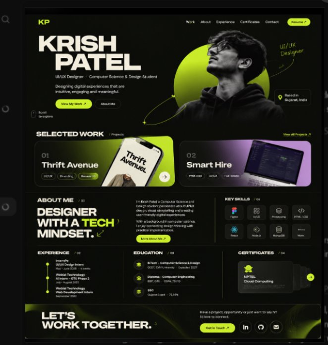

# Krish Patel — Premium Creative UI/UX Portfolio

An award-winning, art-directed personal portfolio and case-study platform built for **Krish Patel** (UI/UX Designer | Computer Science & Design Student at GCET, Gujarat, India).



---

## ✨ Features

- **Art-Directed Aesthetics**: Dark charcoal (`#08080a`) theme with electric lime (`#ccff00`) accents, bold display typography (`Space Grotesk` & `Plus Jakarta Sans`), glassmorphic squircle badges, and glowing ambient mesh orbs.
- **Hero Animation**: Staggered typography reveals, pulsing lime circular aura, orbiting 3D dashed ellipse with star sparkle, handwritten "UI/UX Designer" callout arrow, and interactive mouse parallax on the designer portrait.
- **Curated Projects Showcase**:
  - `01 Thrift Avenue` (UI/UX & Branding — Phone Mockup)
  - `02 Smart Hire` (Full-Stack Web App — Dashboard Mockup)
  - `03 Pet Adoption System` (Web Development & SQL)
  - `04 GourmetGo` (Food Delivery UI/UX)
  - `05 Soundix` (Music & Audio Streaming UI/UX)
  - `06 Nike Air` (Sneaker Concept UI/UX)
  - `07 Brew Haven` (Coffee Brand & UI/UX)
- **Deep Case Study Pages** (`/projects/[slug]`): Comprehensive case-study breakdown with Overview, Core Challenge, Research Insights, Features, Outcomes, Figma links, and Next Project navigation.
- **3-Column Career History**:
  - **Experience**: Timeline with glowing lime nodes for InternPe and Webial Technology.
  - **Education**: GCET (B.Tech Computer Science & Design), BBIT (Diploma in Computer Engineering), SSC.
  - **Certificates**: Stacked interactive cards for NPTEL Cloud Computing, NPTEL IoT (Elite 86%), and Coursera Python with instant Lightbox preview.
- **Private Admin Dashboard (`/admin`)**:
  - Manage Projects (Add, Edit, Delete, Toggle Featured, Toggle Published, Cover Image, Case Studies).
  - Manage Certificates (Add, Edit, Delete, Credential verification links).
  - Manage Experience & Education (Update roles, dates, responsibilities).
  - Profile & Bio Settings (Edit headline, bio paragraphs, CGPA field, contact details).
  - Resume Manager (Upload and replace public PDF download link).
  - Works with Supabase Auth & PostgreSQL, with built-in instant local storage demo fallback for testing!

---

## 🛠️ Tech Stack

- **Framework**: Next.js 16 (App Router) & React 19
- **Styling**: Tailwind CSS v4 & PostCSS
- **Animations**: GSAP 3 & Lucide React Icons
- **Database & Auth**: Supabase PostgreSQL & Supabase Auth
- **Deployment**: Vercel & GitHub

---

## 🚀 Quick Start (Local Development)

1. Clone or open the repository:
   ```bash
   cd "d:\New folder"
   ```

2. Install dependencies:
   ```bash
   npm install
   ```

3. Start development server:
   ```bash
   npm run dev
   ```

4. Open [http://localhost:3000](http://localhost:3000) in your browser.
   - Public Website: `http://localhost:3000`
   - Case Studies: `http://localhost:3000/projects/thrift-avenue`
   - Admin Portal: `http://localhost:3000/admin` (Demo Login: `admin@krishpatel.design` / `krishpatel2026`)

---

## 🗄️ Supabase Setup & Database Migration

1. Create a free project at [supabase.com](https://supabase.com).
2. Go to the **SQL Editor** in your Supabase dashboard.
3. Open `supabase_schema.sql` from this repository, paste the contents, and click **Run**.
   - This creates tables for `profiles`, `projects`, `experiences`, `educations`, `certificates`.
   - Configures Row Level Security (RLS) policies.
   - Creates the `portfolio-assets` storage bucket.
   - Seeds your initial profile data.
4. Copy your project credentials into `.env.local`:
   ```env
   NEXT_PUBLIC_SUPABASE_URL=https://your-project-id.supabase.co
   NEXT_PUBLIC_SUPABASE_ANON_KEY=your-anon-public-key
   ```

---

## 🌐 Deploy to Vercel

1. Push this repository to GitHub:
   ```bash
   git add .
   git commit -m "feat: complete Krish Patel portfolio and admin dashboard"
   git branch -M main
   git remote add origin https://github.com/your-username/krish-patel-portfolio.git
   git push -u origin main
   ```
2. Go to [vercel.com](https://vercel.com) and click **Import Project**.
3. Select your GitHub repository.
4. Add environment variables from `.env.local` (`NEXT_PUBLIC_SUPABASE_URL`, `NEXT_PUBLIC_SUPABASE_ANON_KEY`).
5. Click **Deploy**. Your portfolio will be live at `https://krishpatel.vercel.app`!
